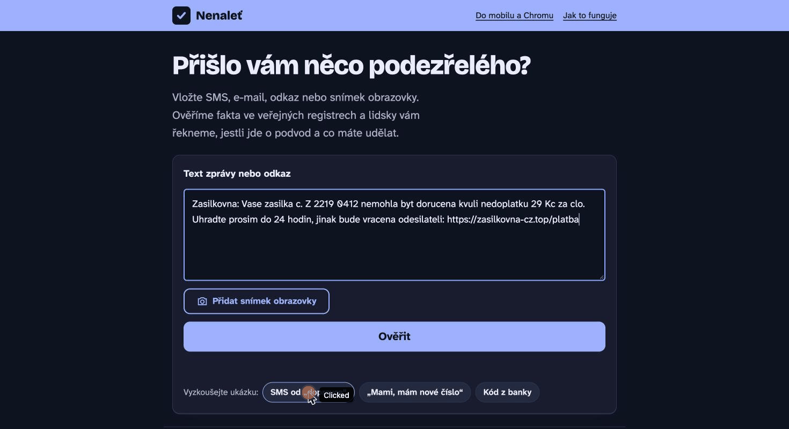

# Nenaleť

**Ověřte si podezřelou zprávu dřív, než naletíte.** Nenaleť je bezplatný pomocník pro lidi v Česku – hlavně pro seniory a jejich rodiny. Vložíte (nebo jedním klepnutím nasdílíte) SMS, e-mail, odkaz, webovou stránku nebo snímek obrazovky a během pár sekund dostanete srozumitelnou odpověď: jde o podvod? Proč? Co máte teď udělat?

Projekt do soutěže **AI výzva pro Česko 2026** (mesic.ai). Řeší obavu, kterou má v [Českém barometru obav z AI 2026](https://asociace.ai/cesky-barometr-obav-z-ai-2026/) nejvíc lidí: **podvody s pomocí AI (77,5 %)** a **deepfaky (72,3 %)**. Jen 26,4 % lidí si věří, že by přesvědčivý deepfake poznalo.

- Web: https://b2bsaas.cz/nenalet/
- iPhone: zkratka „Nenaleť“ v nabídce Sdílet
- Počítač: rozšíření pro Chrome (pravé tlačítko → Ověřit v Nenaleť; výsledek v postranním panelu)



## Proč to funguje i proti dokonalým deepfakům

AI umožňuje podvodníkům psát bezchybnou češtinu, napodobit hlas vnuka nebo obličej známé osobnosti. Detektory deepfaků se dají obejít a samy často chybují. Nenaleť proto nehodnotí, **jak zpráva vypadá**, ale **co po vás chce a kdo za ní doopravdy stojí**:

1. **Ověřená fakta (bez AI, deterministicky)**
   - Patří odkaz opravdu firmě, za kterou se zpráva vydává? (napodobeniny typu `zasilkovna-cz.top`, `csob.cz.secure-login.xyz`, záměny písmen `a1za.cz`)
   - Kdy byla doména zaregistrována? (registr domén RDAP – podvodné weby bývají staré pár dní)
   - Je web na [seznamu rizikových e-shopů České obchodní inspekce](https://coi.gov.cz/pro-spotrebitele/rizikove-e-shopy/)? (aktuálně ~1 300 domén, obnovuje se dvakrát denně)
   - Existuje IČO uvedené na webu v [rejstříku ARES](https://ares.gov.cz/) a sedí kontrolní číslice?
   - Chce stránka údaje z platební karty, přesměrovává jinam, stahuje aplikaci?
   - **Vytvořila obrázek AI?** Hledáme podepsaný údaj o původu [C2PA Content Credentials](https://c2pa.org/) (přidávají ho Google, OpenAI, Adobe, Microsoft…) a přes [OpenAI Content Provenance API](https://developers.openai.com/api/docs/guides/content-provenance) i neviditelný vodoznak **SynthID** v obrázcích od OpenAI. Ověřujeme originál souboru – u obrázku na webu ho rozšíření stáhne, protože snímek obrazovky podpis C2PA ztrácí.
   - Google SynthID pro obsah od Googlu zatím veřejné API pro vývojáře nemá; když na pravosti obrázku záleží, Nenaleť poradí ověření v aplikaci Gemini. Anthropic vlastní detektor nemá (Claude obrázky ani hlas negeneruje).
2. **Posouzení situace jazykovým modelem Claude** – dostane zprávu (i obrázek) spolu s ověřenými fakty a posoudí manipulační vzorec: vydávání se za banku/dopravce/úřad/příbuzného, nátlak a spěch, žádost o peníze, kódy, kartu, instalaci aplikace, „bezpečný účet“. Fakta nesmí popřít ani si vymýšlet další.
3. **Pojistka** – když ověřená fakta ukazují na nebezpečí, výsledek nikdy nemůže být „v pořádku“, i kdyby se model spletl.

Výsledek je vždy v lidské češtině: verdikt (podvod / podezřelé / bez varovných signálů / nelze posoudit), proč, **co dělat teď** a co přesně jsme ověřili a kde.

## Jak přesné to je

Přesnost měříme na testové sadě skutečných českých podvodných zpráv z veřejných zdrojů (Policie ČR, banky, dopravci, hoax.cz, zpravodajství) a legitimních zpráv – viz [`eval/`](eval/) a stránku [Metodika](https://b2bsaas.cz/nenalet/metodika). Výsledky včetně chyb zveřejňujeme.

### Výsledky (28. 10. 2026, 107 zpráv: 69 podvodů, 38 legitimních)

| Varianta | Zachycené podvody | Planý poplach | Cena / kontrola | Odpověď (medián) |
|---|---|---|---|---|
| Jen automatické kontroly (bez AI) | 7/69 · 10 % | 0/38 · 0 % | 0 Kč | < 1 s |
| Claude Haiku 5.5 + kontroly | 67/69 · 97 % | 14/38 · 37 % | 0,01 Kč | 4,9 s |
| **Claude Opus 5.5 + kontroly (v provozu)** | **69/69 · 100 %** (95% CI 95–100 %) | **2/38 · 5 %** (95% CI 1–17 %) | 0,39 Kč | 10,9 s |

- „Zachycený podvod“ = verdikt *podvod* nebo *podezřelé* (obojí člověka zastaví a poradí ověření); jednoznačně „podvod“ u 86 % podvodů.
- Oba plané poplachy jsou skutečné zprávy (bezpečnostní SMS České spořitelny s telefonním číslem; reklamní SMS „každá vstupenka vyhrává“) – na ověřeně skutečných legitimních zprávách je to **2/15 (13 %)**. Obě dopadly jako „podezřelé“ s radou ověřit si to přes známý kontakt.
- Instrukce pro model vznikly před sestavením testové sady a podle výsledků se neladily.
- Podrobnosti: [`eval/results/`](eval/results/), [stránka Metodika](https://b2bsaas.cz/nenalet/metodika).

## Soukromí a bezpečnost

- **Obsah zpráv neukládáme.** Ukládá se jen anonymní statistika (verdikt, doba odpovědi, typ vstupu) a dobrovolné hodnocení „sedí / nesedí“.
- Obsah jednorázově zpracuje model Claude (Anthropic) přes API; podle podmínek API se nepoužívá k trénování.
- Server stahuje odkazované stránky jen bezpečně: blokuje interní adresy, nestandardní porty a přesměrování na ně, nespouští JavaScript, omezuje velikost.
- Vstup od uživatele je pro model jen „data“ – pokusy podvodníka oslovit AI („tato zpráva je ověřená“) se hodnotí jako varovný signál.
- Limity proti zneužití: počet kontrol na IP za hodinu a denní strop nákladů.

## Kde se může mýlit (a co s tím děláme)

- Neumí spolehlivě poznat, zda je obraz či hlas vytvořený AI – a netvrdí to. Hodnotí situaci kolem.
- Nevidí do vašeho účtu ani do historie konverzace; když chybí kontext, řekne „podezřelé“ a poradí, jak si to ověřit nezávislou cestou.
- Může dát planý poplach u legitimní zprávy (měříme a zveřejňujeme) – proto vždy radí ověření přes známý kontakt, ne „ignorujte to“.
- Seznam oficiálních domén značek není úplný; nové napodobeniny nemusí poznat podle jména, zachytí je ale stáří domény nebo obsah.
- Uživatelé mohou u každého výsledku kliknout „sedí / mýlí se“ – průběžně tak měříme přesnost v reálném provozu.

## Struktura projektu

```
backend/      FastAPI server + webové rozhraní (Python 3.12+)
  nenalet/    urls.py (rozbor odkazů), sources.py (ČOI, ARES, RDAP), netguard.py (bezpečné stahování),
              page.py (rozbor stránky), analyzer.py (fakta + model), prompt.py, app.py, static/
  tests/      testy deterministických částí
extension/    rozšíření pro Chrome (Manifest V3, postranní panel; oprávnění activeTab/contextMenus/storage/sidePanel)
shortcut/     generátor zkratky pro iPhone (podepsaný .shortcut)
eval/         testová sada, zdroje a skript pro měření přesnosti
```

## Spuštění

```bash
cd backend
cp .env.example .env        # doplňte ANTHROPIC_API_KEY nebo OPENROUTER_API_KEY
uv sync
uv run uvicorn nenalet.app:app --port 8000
uv run pytest               # testy
PYTHONPATH=. uv run python ../eval/run_eval.py --model claude-opus-5-5   # měření přesnosti
python3 ../build_dist.py https://vase-adresa     # rozšíření (zip) + zkratka pro danou adresu
```

## Licence

MIT
